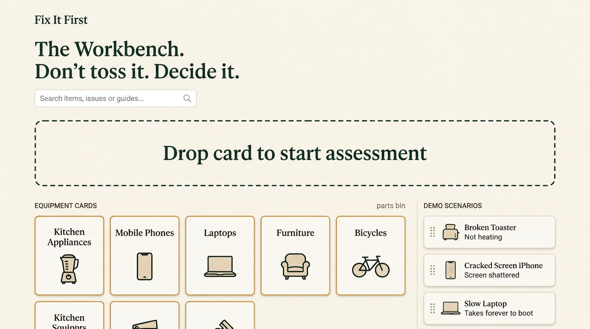
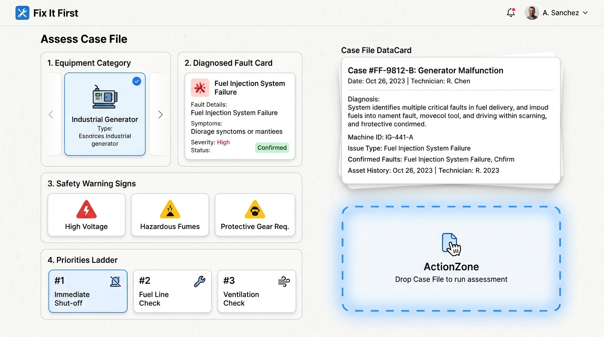
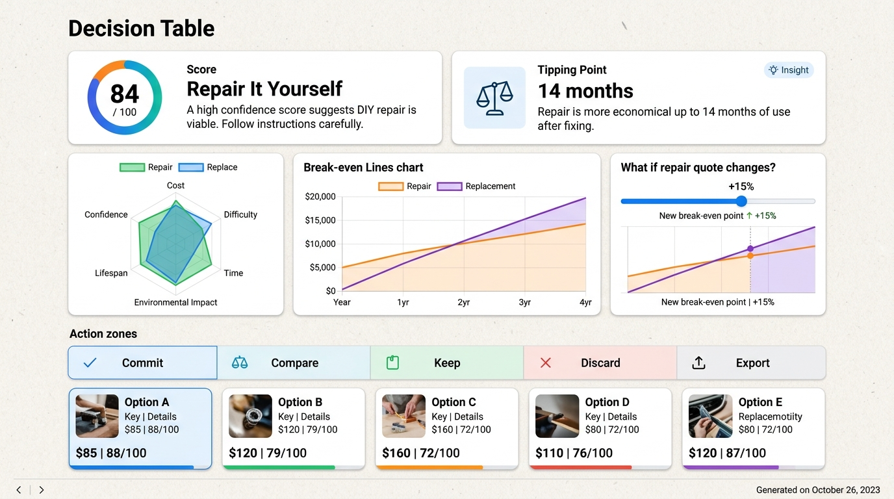

# Fix It First

> 🌐 **Live Demo:** [https://reshma-kn1805.github.io/reshmakarthik08-CodeVariant/](https://reshma-kn1805.github.io/reshmakarthik08-CodeVariant/)  
> **Repository:** `reshma-kn1805/reshmakarthik08-CodeVariant`  
> **Status:** All Phases (1 through 7) Implemented, Tested, Built, and Verified (HTTP 200).

---

## 1. The Problem

Every year, over 53 million metric tons of household appliances, electronics, and consumer goods are discarded prematurely. Consumers faced with a broken blender, cracked screen, or wobbling chair encounter high friction:
- **Commercial Bias**: Search engines and online retail apps push affiliate links to "buy brand new" rather than assess the economics of fixing.
- **Repair Uncertainty**: Users lack transparent visibility into whether a ₹300 part can safely extend an appliance's life by 3 years, or whether the repair quote is an uneconomical trap.
- **Safety Hazards**: Some items (e.g. bulging lithium-ion pouches, smoking motor coils, frayed 230V mains leads) present lethal fire, electrocution, or toxic gas hazards that must NEVER be DIY repaired.

---

## 2. Our Approach: The 5-Way Circular Decision Matrix

**Fix It First** places all 5 circular pathways on an honest, transparent, and mathematically rigorous footing:

1. **Repair**: Evaluates parts availability, repair difficulty, workshop time, and net purchase savings.
2. **Reuse**: Workarounds, secondary household duty, or gifting to family or community tool libraries.
3. **Repurpose**: Category-specific upcycling transformations (e.g., turning an old Android tablet into a smart clock, or jeans into heavy-duty shop aprons).
4. **Replace**: Transparent total cost of ownership including the carbon penalty of manufacturing a new unit.
5. **Recycle**: Safe municipal e-waste decommissioning, battery isolation, and circular material recovery.

---

## 3. How Scoring Works

### The 6 Evaluated Factors & Default Weights

Each of the 5 options is rated on a `0–10` scale across 6 core criteria, then combined into a normalized score out of `100`:

| Factor | Default Weight | Description |
| :--- | :---: | :--- |
| **Cost** | `30%` | Financial out-of-pocket spend compared to new replacement purchase. |
| **Practicality** | `20%` | Fault severity, DIY difficulty, and local spare parts commonality. |
| **Remaining Life** | `15%` | Projected useful lifespan gained from taking this path. |
| **Environment** | `15%` | Embodied carbon ($\text{CO}_2\text{e}$) diverted from landfills and avoided manufacturing. |
| **Safety** | `10%` | **LOCKED at 10%**. Strict protection against acute thermal, electrical, and chemical hazards. |
| **Effort** | `10%` | Convenience and time investment required by the user. |

### Dynamic Priority Weights

Users can adjust their personal balance via three sliders (0–100):
- **Save Money**: Proportionally increases the **Cost** weight.
- **Reduce Waste**: Proportionally increases **Environment** and **Remaining Life** weights.
- **Save Effort**: Proportionally increases the **Effort** weight.

> [!IMPORTANT]
> **Safety Weight Guarantee**: Regardless of slider adjustments, the **Safety weight is permanently locked at 10%**, and all weights strictly sum to **100%**.

### Acute Safety Gate ("Don't DIY This")

If a critical safety red-line hazard is detected (swollen battery, burning odor, electrical sparks, or exposed mains wiring), the engine triggers an immediate safety lockout:
- The standard decision verdict is replaced with a distinct Rust-red (`#C8553D`) **"Don't DIY This"** warning.
- DIY pathways are locked out (`safety = 0`, `practicality = 0`, `remainingLife = 0`).
- The user is provided clear routing to either **Route A (Brand-Authorized Professional)** or **Route B (Certified Municipal E-Waste Drop-off)**.

### Signature Feature: Tipping Point Analysis

Underneath the hero verdict, the engine computes the exact financial threshold using `tippingPoint(input, rules)`:

$$\text{"Repair stays the best choice unless the repair quote goes above ₹X."}$$

The engine sweeps the repair cost from current to $3\times$ replacement benchmark, identifying the exact rupee point where the top-ranked recommendation flips to an alternate option (e.g., Replace or Recycle).

---

## 4. Visual Interface & Architecture

### The Workbench (`#/`)

*Tactile Parts Bin with 8 equipment categories, 3 instant scenarios, and the glowing Start Assessment action zone.*

### Assess Case File Canvas (`#/assess`)

*Unified Case File workspace: Category slot, What's Wrong diagnosis, Safety warning signs, and Priorities Ladder.*

### The Decision Table (`#/verdict/:id`)

*5-way parallel scoring, 6-factor SVG Radar Chart, Break-even Line Chart, Quote Sensitivity Slider, and Commit / Compare / Keep / Discard / Export Action Zones.*

---

## 5. 1-Click Instant Test Scenarios

The home page (`/`) features 3 instant scenarios jumping straight into live scored verdicts:

1. **5-year-old Mixer Grinder**: Stripped drive coupler ($₹180$ part vs $₹3,500$ new). **Repair wins** with 92/100 score.
2. **Phone with Swollen Battery**: Bulging lithium pouch pushing screen glass. **Safety Gate triggered** (`#C8553D` screen locks out DIY).
3. **Old Wooden Study Chair**: Structural tenon joint split where repair ($₹2,400$) is near new ($₹2,600$). **Replace wins**.

---

## 6. The Canvas Protocol Interaction Layer

Under **The Canvas Protocol**, traditional action buttons for primary operations (Submit, Save, Delete, Assess, Compare, etc.) are strictly prohibited. All primary actions are performed by dragging and dropping data cards into designated **Action Zones**:

- **The Workbench (`/`)**: Drag category cards or preloaded example cards into the **"Start assessment"** zone (`zone-start-assessment`).
- **The Case File Canvas (`/assess`)**: Replaces the multi-step wizard with a single interactive surface. Drag category, fault, and safety sign cards into slots, tune the Priorities Ladder, and drop the live **Case File** card into **"Run assessment"** (`zone-run-assessment`).
- **The Decision Table (`/verdict/:id`)**: Drag option cards into **"Commit to this option"** (`zone-commit`), **"Compare"** (`zone-compare`), **"Keep"** (`zone-keep`), **"Discard"** (`zone-discard`), or **"Export summary"** (`zone-export`). If safety red-lines are detected, DIY options are locked with rust badges and bounce back upon drop.
- **The Archive (`/history`)**: Drag history cards into **"Reopen & Edit"**, **"Compare"**, or **"Discard"**.
- **Full Accessibility**: Space/Enter lifts a card, arrow keys cycle through valid target zones, Space/Enter drops, and Esc cancels.

### Where Zones and Actions are Configured
- **Zone Registry**: [`src/config/zones.js`](file:///c:/dev/reshmakarthik08-CodeVariant/src/config/zones.js)
- **Drop Reducer Logic**: [`src/canvas/actions.js`](file:///c:/dev/reshmakarthik08-CodeVariant/src/canvas/actions.js) (`applyDrop`)
- **Detailed Protocol Reference**: See [`SURPRISE_CHALLENGE.md`](file:///c:/dev/reshmakarthik08-CodeVariant/SURPRISE_CHALLENGE.md)

---

## 7. Technology Stack

- **Core**: React 18, Vite 6, Plain JavaScript (JSX)
- **Approved D&D Primitives**: `@dnd-kit/core`, `@dnd-kit/utilities`
- **Styling**: Vanilla Tailwind CSS 3.4 with Workshop theme tokens:
  - **Amber (`#E39A2D` / `#E09F3E`)**: Exclusively reserved for primary action CTAs and interactive affordances.
  - **Rust (`#C8553D`)**: Exclusively reserved for safety hazards and the lockout screen.
  - **Deep Green (`#1D4D3F`) & Green (`#2E7D5B`)**: Sustainability indicators and brand hierarchy.
- **Routing**: `HashRouter` (ensures zero 404s on GitHub Pages browser refresh)
- **State & Persistence**: React Context + `sessionStorage` (100% private, zero telemetry, persists across page refreshes)
- **Icons**: `lucide-react`
- **Testing**: `vitest` unit test suite covering scoring math, edge cases, button ban enforcement, and user journeys (67 tests passing)

---

## 8. Running Locally

```bash
# 1. Clone repository
git clone https://github.com/reshma-kn1805/reshmakarthik08-CodeVariant.git
cd reshmakarthik08-CodeVariant

# 2. Install dependencies
npm install

# 3. Run unit tests (67 tests across 5 suites)
npm test

# 4. Start local development server
npm run dev

# 5. Build for production
npm run build
```

---

## 9. Verification & Deployment

- **Continuous Deployment**: Automated via `.github/workflows/deploy.yml` on push to `main` using Node 20.
- **Live URL**: [https://reshma-kn1805.github.io/reshmakarthik08-CodeVariant/](https://reshma-kn1805.github.io/reshmakarthik08-CodeVariant/)
- **Architecture Documentation**: See [ARCHITECTURE.md](file:///c:/dev/reshmakarthik08-CodeVariant/ARCHITECTURE.md) for the "Where to Change What" map.
- **Surprise Challenge Documentation**: See [SURPRISE_CHALLENGE.md](file:///c:/dev/reshmakarthik08-CodeVariant/SURPRISE_CHALLENGE.md) for protocol details and 60s demo script.
